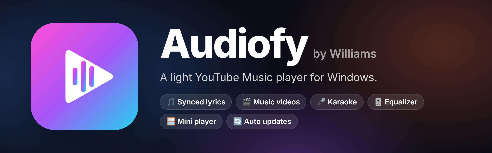
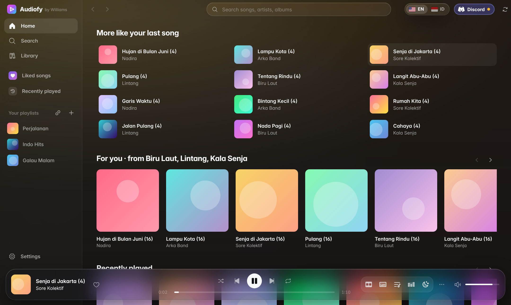
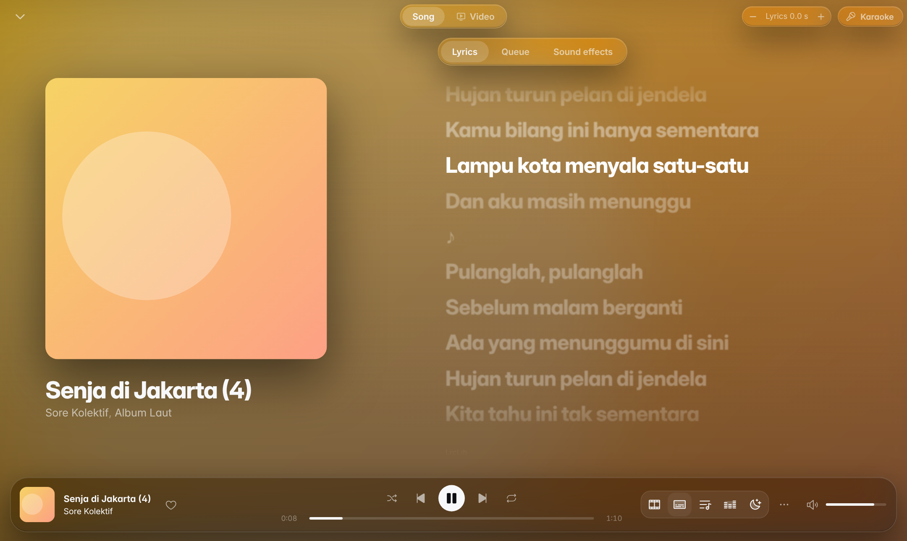
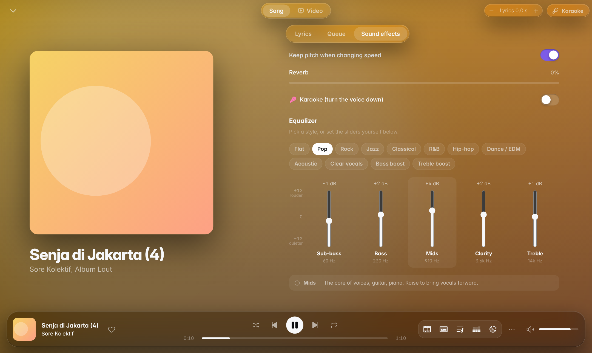
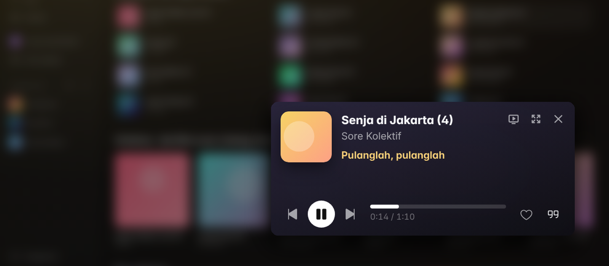

  

  
  
  
  

  <b>Pemutar musik untuk kita semua.</b> 
  Dengarkan lagu dari YouTube Music di Windows: ringan, cepat, lengkap dengan lirik, 
  video musik, karaoke, dan equalizer. Tanpa perlu akun.

  <a href="https://github.com/RoocHelper/audiofy/releases/latest"><b>⬇️ Unduh Audiofy</b></a>
  &nbsp;·&nbsp;
  <a href="README.md">🇺🇸 Read in English</a>

---

## ✨ Fitur

### 🎵 Dengarkan apa saja
- **Cari** lagu, album, artis, dan playlist dari katalog YouTube Music.
- **Beranda** berisi lagu teratas dan lagu yang sedang naik di Amerika Serikat (bisa diganti ke negara mana pun, termasuk Indonesia, di Pengaturan), rilis baru, serta genre.
- **Untukmu**: rekomendasi dari artis yang paling sering kamu putar dan sukai.
- **Langsung diputar** tanpa menunggu unduhan; lagu berikutnya disiapkan lebih dulu, jadi pindah lagu terasa instan.
- **Koleksi**: suka lagu, simpan album/artis/playlist, buat playlist sendiri, dan simpan antrean yang sedang diputar jadi playlist.
- **Bagikan lagu**: salin link YouTube Music-nya untuk dikirim ke teman.
- **Impor playlist dari link** YouTube / YouTube Music: tempel link-nya, isinya jadi playlist di Audiofy.
- **Radio otomatis**: saat antrean habis, lagu serupa terus diputar.

### 🌐 Bahasa Inggris atau Indonesia
- Audiofy dibuka dalam **bahasa Inggris**. Ganti ke **Bahasa Indonesia** (dan sebaliknya) dengan tombol bendera di bagian atas jendela.

### 📝 Lirik tersinkron

- Lirik bergerak mengikuti lagu, baris yang sedang dinyanyikan disorot. Klik satu baris untuk melompat ke bagian itu.
- Bila lirik terasa terlalu cepat/lambat, geser dengan tombol **− / +** (tahan Shift untuk 5 detik).

### 🎬 Video musik resmi
- Tombol **Video** menampilkan video musik resminya, sinkron dengan lagu, dengan lirik sebagai subtitle.
- Lirik otomatis **menunggu intro video** sebelum mulai.
- Pilih kualitas video seperti di YouTube: Otomatis, 1440p, 1080p, 720p, 480p, 360p. Ganti kualitas tanpa layar berkedip.

### 🎤 Karaoke & 🎚️ Equalizer

- **Karaoke** dengan satu tombol: suara penyanyi dihilangkan, bass dan drum tetap ada. Kekuatannya bisa diatur.
- **Equalizer** dengan pilihan siap pakai: Pop, Rock, Jazz, Klasik, R&B, Hip-hop, Dance/EDM, Akustik, Vokal jernih, Bass kuat, Treble kuat. Setiap slider punya nama dan penjelasan (Bass dalam, Bass, Tengah, Kejelasan, Treble).
- Efek lain: kecepatan putar, reverb, Slowed + reverb, Nightcore, penyamaan volume antar lagu, crossfade.

### 🪟 Mini player

- **Ctrl+M** (atau tombol di kanan atas) mengubah Audiofy jadi jendela kecil yang selalu di atas aplikasi lain, cocok sambil kerja atau main game.
- Menampilkan sampul dan lirik, atau **video musik** bila mode Video menyala.

### 🧩 Menyatu dengan Windows
- **System tray**: tombol X dan minimize menyembunyikan Audiofy ke dekat jam, musik tetap jalan. Klik kanan ikonnya untuk putar/jeda, lagu berikutnya, volume, atau keluar.
- **Kontrol di taskbar**: arahkan mouse ke ikon Audiofy di taskbar untuk tombol sebelumnya, putar/jeda, berikutnya, bisukan, dan volume.
- **Tombol media keyboard** dan kontrol media Windows (layar kunci, panel volume) ikut berfungsi.
- **Pilih speaker / headset** langsung dari Audiofy (bawaannya mengikuti Windows).
- **Timer tidur**: 15–90 menit atau di akhir lagu; musik mengecil pelan lalu berhenti.

### 💬 Status Discord
- Teman Discord melihat **"Listening to Audiofy"** lengkap dengan judul, penyanyi, sampul, dan sisa waktu.
- Nyala/mati dengan satu klik lewat tombol **Discord** di bagian atas jendela. Lampu hijau = lagu sedang tampil, kuning = menunggu aplikasi Discord.

### 🔒 Aman & praktis
- **Update otomatis**: Audiofy memberi tahu bila ada versi baru dan memasangnya dengan satu klik. Setiap update ditandatangani, jadi update palsu ditolak.
- **Cadangkan & pulihkan** koleksi dan pengaturan ke satu file, untuk pindah PC atau setelah instal ulang Windows.
- **Ringan**: hanya sekitar 20 MB, memakai mesin web bawaan Windows (WebView2), dan lagu tidak disimpan ke disk.

---

## ⬇️ Unduh & pasang

Buka **[halaman rilis terbaru](https://github.com/RoocHelper/audiofy/releases/latest)**, lalu pilih:

| File | Untuk siapa |
|---|---|
| `Audiofy_x.y.z_x64-setup.exe` | **Disarankan.** Dipasang seperti aplikasi biasa, muncul di menu Start, dan **update otomatis**. |
| `Audiofy_x.y.z_portable.zip` | Tanpa instal: ekstrak lalu jalankan `Audiofy.exe` (biarkan `WebView2Loader.dll` di folder yang sama). Tidak bisa update sendiri. |

**Kebutuhan:** Windows 10 atau 11 (64-bit) dan Microsoft Edge WebView2 (sudah ada di Windows 11 dan kebanyakan Windows 10).

> **Windows SmartScreen** mungkin menampilkan "Windows protected your PC" karena aplikasi ini belum memiliki sertifikat berbayar. Klik **More info → Run anyway**.

---

## ⌨️ Pintasan keyboard

| Tombol | Fungsi |
|---|---|
| `Spasi` | Putar / jeda |
| `Ctrl + →` / `Ctrl + ←` | Lagu berikutnya / sebelumnya |
| `Ctrl + ↑` / `Ctrl + ↓` | Volume naik / turun |
| `Ctrl + K` atau `/` | Cari |
| `Ctrl + M` | Mini player |
| `F` | Layar penuh (mode Video) |
| `Esc` | Tutup layar pemutar |

---

## ❓ Pertanyaan umum

<b>Perlu akun Google / YouTube?</b>

Tidak. Audiofy bekerja tanpa login. Koleksi dan playlist disimpan di PC-mu sendiri. Playlist dari akun YouTube bisa dibawa dengan fitur **Impor playlist dari link** (playlist harus Public atau Unlisted).

<b>Lirik lagu tertentu tidak ada?</b>

Lirik diambil dari [LrcLib](https://lrclib.net), database lirik dari komunitas, dengan cadangan lirik dari YouTube Music. Beberapa lagu memang belum punya lirik di sana.

<b>Di mana data saya disimpan?</b>

Di `%APPDATA%\com.williams.audiofy` (koleksi, playlist, pengaturan, log). Gunakan **Pengaturan → Cadangan koleksi** untuk menyimpannya ke file.

<b>Status Discord tidak muncul?</b>

Pastikan aplikasi Discord **desktop** sedang terbuka, dan di Discord **User Settings → Activity Privacy → Share my activity** menyala. Tombol Discord di bagian atas Audiofy menunjukkan statusnya: titik hijau berarti lagu sedang tampil, titik kuning berarti menunggu Discord dibuka.

---

## 🙏 Terima kasih

Audiofy dikembangkan dari **[Square](https://github.com/Lelonio/Square)** karya Lelonio (aplikasi YouTube Music untuk Android), dan dibangun dengan:
[Tauri](https://tauri.app) · [Svelte](https://svelte.dev) · [RustyPipe](https://codeberg.org/ThetaDev/rustypipe) · [yt-dlp-ejs](https://github.com/yt-dlp/ejs) · [LrcLib](https://lrclib.net) · [Phosphor Icons](https://phosphoricons.com)

## 📄 Lisensi

[GPL-3.0](LICENSE). Kode sumber setiap versi ada di halaman rilis (`audiofy-source-x.y.z.zip`).

Audiofy adalah proyek pribadi dan **tidak berafiliasi dengan Google, YouTube, atau Discord**. Semua lagu, video, dan merek dagang adalah milik pemiliknya masing-masing.

