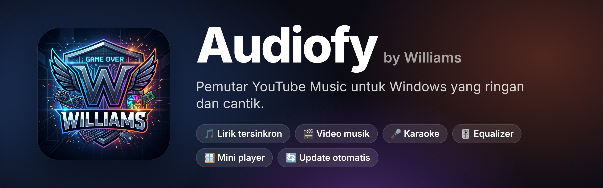
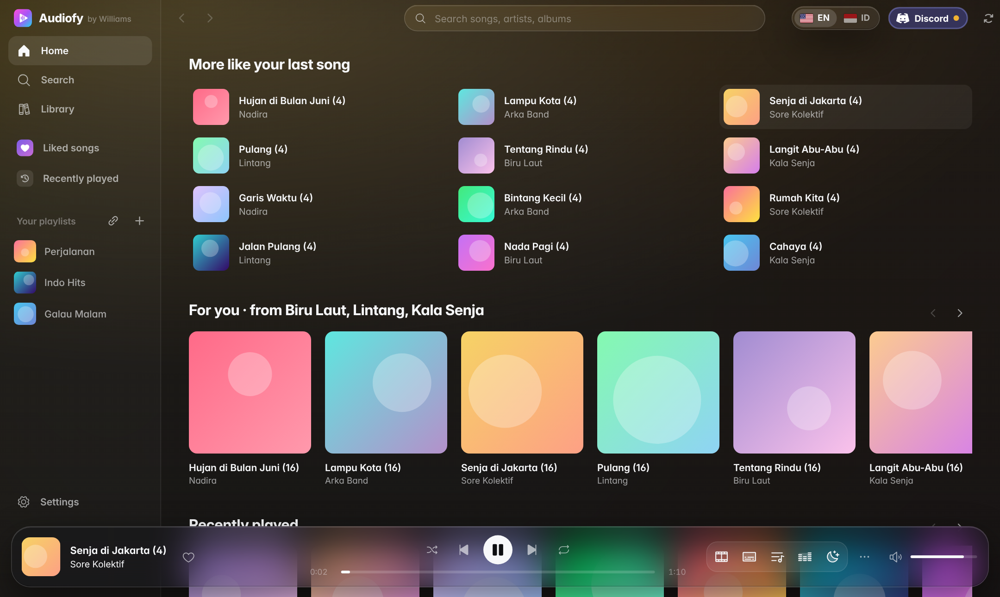
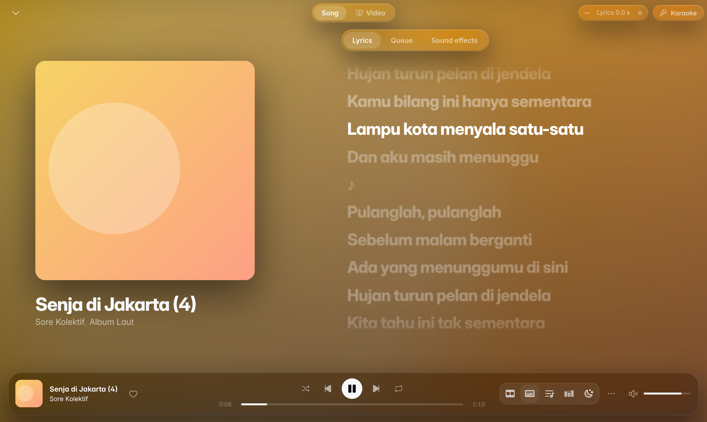
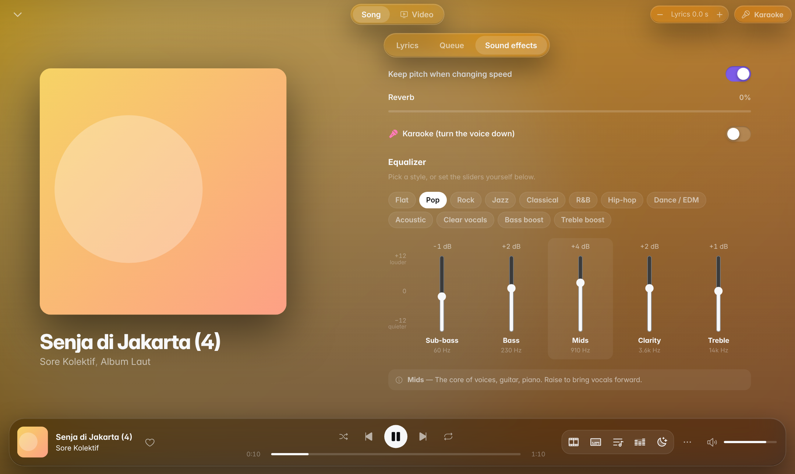
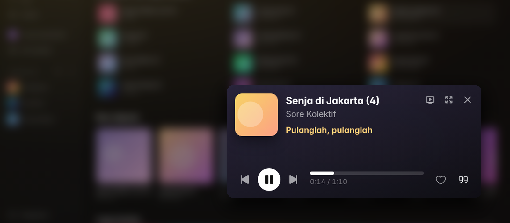

  

  
  
  
  

  <b>Pemutar musik untuk kita semua.</b> 
  Dengarkan lagu dari YouTube Music di Windows: ringan, cepat, lengkap dengan lirik, 
  video musik, karaoke, dan equalizer. Tanpa perlu akun.

  <a href="https://github.com/RoocHelper/audiofy/releases/latest"><b>⬇️ Unduh Audiofy</b></a>
  &nbsp;·&nbsp;
  <a href="README.md">🇺🇸 Read in English</a>

---

## ✨ Fitur

### 🎵 Dengarkan apa saja
- **Cari** lagu, album, artis, dan playlist dari katalog YouTube Music.
- **Beranda** berisi lagu teratas di negaramu (otomatis dari lokasi perangkat) **dan** lagu teratas global, rilis baru, serta genre.
- **Langsung diputar** tanpa menunggu unduhan; lagu berikutnya disiapkan lebih dulu, jadi pindah lagu terasa instan.
- **Koleksi**: suka lagu, simpan album/artis/playlist, dan buat playlist sendiri.
- **Impor playlist dari link** YouTube / YouTube Music: tempel link-nya, isinya jadi playlist di Audiofy.
- **Radio otomatis**: saat antrean habis, lagu serupa terus diputar.

### 🌐 Bahasa Inggris atau Indonesia
- Audiofy dibuka dalam **bahasa Inggris**. Ganti ke **Bahasa Indonesia** (dan sebaliknya) dengan tombol bendera di bagian atas jendela.

### 🎮 Aman untuk streaming

- Musik yang boleh diputar saat live di **Twitch, YouTube, atau Kick**, per genre: Gaming & EDM, Lofi & chill, Nuansa Jepang (gaya anime), Synthwave, Hip-hop beats, Ambient & fokus, Rock.
- Hanya dari sumber resmi: **StreamBeats** karya Harris Heller (gratis, tanpa kredit) dan **NCS** (gratis dengan kredit). Bukan unggahan ulang "no copyright" sembarangan.
- **Mode streaming** (tombol di atas): hanya lagu aman yang diputar, lagu lain dilewati, dan saat antrean habis Audiofy lanjut dengan lagu aman dari genre yang sama, jadi tidak ada lagu acak yang masuk ke stream.
- Saat Mode streaming aktif, **Beranda hanya menampilkan lagu aman**: satu tombol memutar semuanya secara acak, plus satu baris per genre. Pencarian tetap menampilkan semua lagu, dengan perisai hijau atau merah di tiap lagu.
- **Salin semua kredit** satu sesi streaming dengan satu tombol, siap ditempel di deskripsi stream atau VOD.
- **OBS**: Audiofy bisa menulis lagu yang diputar ke file teks (sumber Text) atau menampilkan overlay "Now playing" dengan sampul dan bar waktu (sumber Browser).
- Perisai hijau di pemutar menandakan lagu aman; klik (atau klik kanan lagu > **Salin kredit**) untuk menyalin kredit ke deskripsi stream.

### 📝 Lirik tersinkron

- Lirik bergerak mengikuti lagu dan **menyala per kata saat dinyanyikan**: tiap kata terisi, sedikit mengembang, terangkat, lalu tenang. Baris lain meredup dan makin blur sesuai jaraknya, dan jeda instrumental jadi tiga titik yang berdenyut.
- Waktu per kata diambil dari [LrcLib](https://lrclib.net). Lagu yang belum punya waktu per kata tetap tampil per baris.
- Lebih suka tampilan sederhana, atau PC-nya sudah lama? **Pengaturan → Lirik → Gaya lirik → Per baris (biasa)**.
- Klik satu baris untuk melompat ke bagian itu.
- Bila lirik terasa terlalu cepat atau lambat, geser dengan tombol **− / +** di samping "Lirik" (tahan Shift untuk 5 detik).
- **Jeda lirik** per speaker atau headset (**Pengaturan → Lirik**): headset Bluetooth memainkan suara sesaat setelah pemutar, jadi liriknya terasa cepat. Geser sampai pas; setelannya diingat sendiri-sendiri untuk tiap perangkat.
- **Huruf Latin** untuk lagu Korea, Jepang, dan Cina (사랑해 → saranghae), di bawah lirik atau menggantikannya.

### 🎬 Video musik resmi
- Tombol **Video** menampilkan video musik resminya, sinkron dengan lagu, dengan lirik sebagai subtitle.
- Lirik otomatis **menunggu intro video** sebelum mulai.
- Pilih kualitas video seperti di YouTube: Otomatis, 1440p, 1080p, 720p, 480p, 360p. Ganti kualitas tanpa layar berkedip.

### 🎤 Karaoke & 🎚️ Equalizer

- **Karaoke** dengan satu tombol: suara penyanyi dihilangkan, bass dan drum tetap ada. Kekuatannya bisa diatur.
- **Ganti nada (key)** naik atau turun (±6) tanpa mengubah kecepatan, supaya pas dengan suaramu.
- **Dengar suaraku**: suara mic keluar di speaker atau headset bersama musik, dengan gema dan reverb. Audiofy menampilkan jeda yang terukur; paling enak pakai headset kabel.
- **Layar karaoke**: video musik layar penuh dengan lirik di bawah seperti subtitle karaoke (baris yang dinyanyikan dan baris berikutnya), warna berjalan per kata, dan hitung mundur 3‑2‑1 sebelum mulai menyanyi lagi. Ukuran lirik (kecil/sedang/besar) dan posisinya (bawah/atas) bisa diatur, dan ada slider **vokal panduan** untuk menyisakan sedikit suara penyanyi.
- **Antrean nyanyi** untuk pesta: tulis siapa yang menyanyi tiap lagu, dan namanya muncul saat lagunya mulai ("Berikutnya: Sari" menjelang akhir lagu sebelumnya).
- Saat layar penuh (layar karaoke dan video musik), bar dan kursor menghilang setelah 3 detik mouse diam; gerakkan mouse untuk memunculkannya lagi.

- **Equalizer** dengan pilihan siap pakai: Pop, Rock, Jazz, Klasik, R&B, Hip-hop, Dance/EDM, Akustik, Vokal jernih, Bass kuat, Treble kuat. Setiap slider punya nama dan penjelasan (Bass dalam, Bass, Tengah, Kejelasan, Treble).
- Efek lain: kecepatan putar, reverb, Slowed + reverb, Nightcore, penyamaan volume antar lagu, crossfade.

### 🪟 Mini player

- **Ctrl+M** (atau tombol di kanan atas) mengubah Audiofy jadi jendela kecil yang selalu di atas aplikasi lain, cocok sambil kerja atau main game.
- Menampilkan sampul dan lirik, atau **video musik** bila mode Video menyala.

### 🧩 Menyatu dengan Windows
- **System tray**: tombol X dan minimize menyembunyikan Audiofy ke dekat jam, musik tetap jalan. Klik kanan ikonnya untuk putar/jeda, lagu berikutnya, volume, atau keluar.
- **Kontrol di taskbar**: arahkan mouse ke ikon Audiofy di taskbar untuk tombol sebelumnya, putar/jeda, berikutnya, bisukan, dan volume.
- **Tombol media keyboard** dan kontrol media Windows (layar kunci, panel volume) ikut berfungsi.
- **Pilih speaker / headset** langsung dari Audiofy (bawaannya mengikuti Windows).
- **Timer tidur**: 15–90 menit atau di akhir lagu; musik mengecil pelan lalu berhenti.

### 💬 Status Discord
- Teman Discord melihat **"Listening to Audiofy"** lengkap dengan judul, penyanyi, sampul, dan sisa waktu.
- Nyala/mati dengan satu klik lewat tombol **Discord** di bagian atas jendela. Lampu hijau = lagu sedang tampil, kuning = menunggu aplikasi Discord.

### 🔒 Aman & praktis
- **Update otomatis**: Audiofy memberi tahu bila ada versi baru dan memasangnya dengan satu klik. Setiap update ditandatangani, jadi update palsu ditolak.
- **Pengaturanmu tetap milikmu**: Audiofy hanya menyimpan setelan yang kamu ubah, jadi yang tidak pernah kamu sentuh ikut bawaan yang lebih baik di versi berikutnya, sementara pilihanmu sendiri tidak pernah ditimpa saat update.
- **Cadangkan & pulihkan** koleksi dan pengaturan ke satu file, untuk pindah PC atau setelah instal ulang Windows.
- **Ringan**: hanya sekitar 20 MB, memakai mesin web bawaan Windows (WebView2), dan lagu tidak disimpan ke disk.

---

## ⬇️ Unduh & pasang

Buka **[halaman rilis terbaru](https://github.com/RoocHelper/audiofy/releases/latest)**, lalu pilih:

| File | Untuk siapa |
|---|---|
| `Audiofy_x.y.z_x64-setup.exe` | **Disarankan.** Dipasang seperti aplikasi biasa, muncul di menu Start, dan **update otomatis**. |
| `Audiofy_x.y.z_portable.zip` | Tanpa instal: ekstrak lalu jalankan `Audiofy.exe` (biarkan `WebView2Loader.dll` di folder yang sama). Tidak bisa update sendiri. |

**Kebutuhan:** Windows 10 atau 11 (64-bit) dan Microsoft Edge WebView2 (sudah ada di Windows 11 dan kebanyakan Windows 10).

> **Windows SmartScreen** mungkin menampilkan "Windows protected your PC" karena aplikasi ini belum memiliki sertifikat berbayar. Klik **More info → Run anyway**.

---

## ⌨️ Pintasan keyboard

| Tombol | Fungsi |
|---|---|
| `Spasi` | Putar / jeda |
| `Ctrl + →` / `Ctrl + ←` | Lagu berikutnya / sebelumnya |
| `Ctrl + ↑` / `Ctrl + ↓` | Volume naik / turun |
| `Ctrl + K` atau `/` | Cari |
| `Ctrl + M` | Mini player |
| `F` | Layar penuh (mode Video) |
| `Esc` | Tutup layar pemutar |

---

## ❓ Pertanyaan umum

<b>Perlu akun Google / YouTube?</b>

Tidak. Audiofy bekerja tanpa login. Koleksi dan playlist disimpan di PC-mu sendiri. Playlist dari akun YouTube bisa dibawa dengan fitur **Impor playlist dari link** (playlist harus Public atau Unlisted).

<b>Lirik lagu tertentu tidak ada?</b>

Lirik diambil dari [LrcLib](https://lrclib.net), database lirik dari komunitas, dengan cadangan lirik dari YouTube Music. Beberapa lagu memang belum punya lirik di sana.

<b>Kenapa ada lagu yang liriknya tidak menyala per kata?</b>

Karena tidak semua lirik di LrcLib punya waktu per kata; sebagian baru punya waktu per baris. Lagu seperti itu tetap tampil, hanya saja barisnya yang disorot, bukan katanya. Semakin banyak lirik yang dilengkapi di LrcLib, semakin banyak lagu yang menyala per kata, tanpa perlu update Audiofy.

<b>Di mana data saya disimpan?</b>

Di `%APPDATA%\com.williams.audiofy` (koleksi, playlist, pengaturan, log). Gunakan **Pengaturan → Cadangan koleksi** untuk menyimpannya ke file.

<b>Status Discord tidak muncul?</b>

Pastikan aplikasi Discord **desktop** sedang terbuka, dan di Discord **User Settings → Activity Privacy → Share my activity** menyala. Tombol Discord di bagian atas Audiofy menunjukkan statusnya: titik hijau berarti lagu sedang tampil, titik kuning berarti menunggu Discord dibuka.

---

## 🙏 Terima kasih

Audiofy dikembangkan dari **[Square](https://github.com/Lelonio/Square)** karya Lelonio (aplikasi YouTube Music untuk Android), dan dibangun dengan:
[Tauri](https://tauri.app) · [Svelte](https://svelte.dev) · [RustyPipe](https://codeberg.org/ThetaDev/rustypipe) · [yt-dlp-ejs](https://github.com/yt-dlp/ejs) · [LrcLib](https://lrclib.net) · [SoundTouchJS](https://github.com/cutterbl/SoundTouchJS) · [Phosphor Icons](https://phosphoricons.com)

## 📄 Lisensi

[GPL-3.0](LICENSE). Kode sumber setiap versi ada di halaman rilis (`audiofy-source-x.y.z.zip`).

Audiofy adalah proyek pribadi dan **tidak berafiliasi dengan Google, YouTube, atau Discord**. Semua lagu, video, dan merek dagang adalah milik pemiliknya masing-masing.
