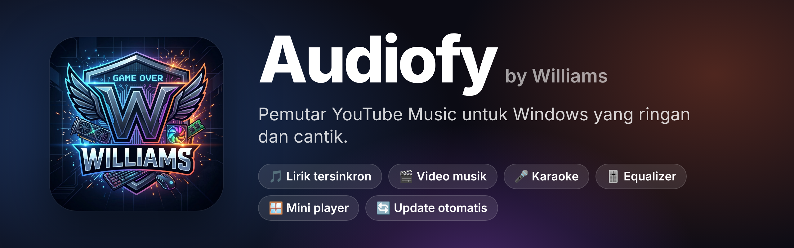
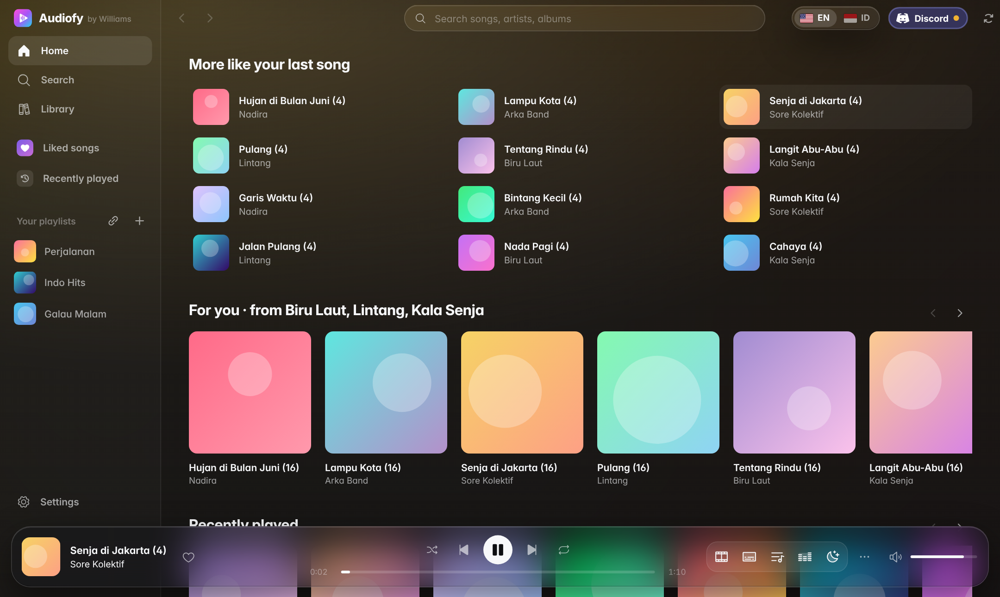
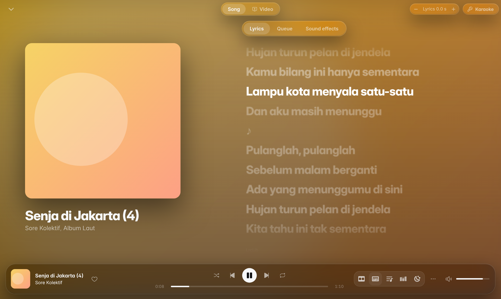
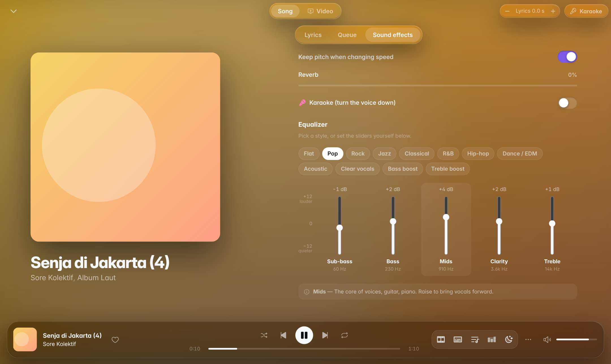
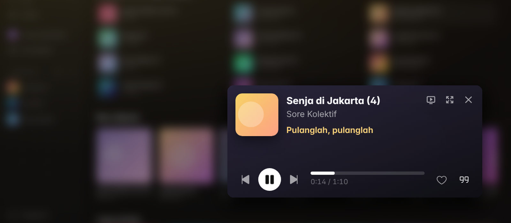

  

  
  
  
  

  <b>A music player for everyone.</b> 
  Listen to YouTube Music on Windows: light, quick, with lyrics, 
  music videos, karaoke and an equalizer. No account needed.

  <a href="https://github.com/RoocHelper/audiofy/releases/latest"><b>⬇️ Download Audiofy</b></a>
  &nbsp;·&nbsp;
  <a href="README.id.md">🇮🇩 Baca dalam Bahasa Indonesia</a>

---

## ✨ Features

### 🎵 Listen to anything
- **Search** songs, albums, artists and playlists from the YouTube Music catalogue.
- **Home** shows your country's top songs (found from the device) **and** the global charts, new releases and genres.
- **Plays straight away**, with nothing to download first; the next song is made ready in advance, so skipping is instant.
- **Your library**: like songs, save albums, artists and playlists, and build playlists of your own.
- **Import a playlist from a link** — paste a YouTube or YouTube Music playlist link and it becomes a playlist in Audiofy.
- **Radio**: when the queue runs out, songs like the last one keep playing.

### 🌐 English or Indonesian
- Audiofy opens in **English**. Switch to **Bahasa Indonesia**, and back, with the flag button at the top of the window.

### 🎮 Safe for streaming

- Music you may play while live on **Twitch, YouTube or Kick**, by genre: Gaming & EDM, Lofi & chill, Japanese mood (anime style), Synthwave, Hip-hop beats, Ambient & focus, Rock.
- From the official sources only: **StreamBeats** by Harris Heller (free, no credit needed) and **NCS** (free with credit) — not random "no copyright" re-uploads.
- **Streaming mode** (the button at the top): only safe songs play, anything else is skipped, and when the queue runs out Audiofy carries on with safe songs from the same genre, so nothing unexpected reaches your stream.
- With streaming mode on, **Home shows safe music only**: one button shuffles all of it, plus a row for each genre. Search still shows everything, with a green or red shield on each song.
- **Copy every credit** from a streaming session with one button, ready to paste into the stream or VOD description.
- **OBS**: Audiofy can write the song playing to a text file (Text source) or show a "Now playing" overlay with the cover and a time bar (Browser source).
- The green shield in the player marks a safe song; click it (or right-click a song > **Copy credit**) to copy its credit.

### 📝 Synced lyrics

- The lyrics follow the song and **light up word by word as they are sung**: each word fills, swells a little, lifts, then settles. The other lines dim and fade out of focus with distance, and an instrumental break shows three breathing dots.
- The word timings come from [LRCLIB](https://lrclib.net). A song whose lyrics are timed by the line still shows, a line at a time.
- Prefer it plain, or running on an older PC? **Settings → Lyrics → Lyrics style → Line by line (plain)**.
- Click any line to jump to that part of the song.
- If the lyrics run early or late, shift them with the **− / +** buttons beside "Lyrics" (hold Shift for 5 seconds).
- **Lyrics delay**, kept for each speaker or headset of its own (**Settings → Lyrics**): a Bluetooth headset plays the sound a moment after the player has it, so the words run early. Move the slider until they fit; each device keeps its own setting.
- **Latin letters** for Korean, Japanese and Chinese songs (사랑해 → saranghae), under the lyrics or in place of them.

### 🎬 Official music videos
- The **Video** button plays the song's official music video in step with the music, with the lyrics as subtitles.
- The lyrics **wait for the video's intro** before they start.
- Pick the quality as you would on YouTube: Auto, 1440p, 1080p, 720p, 480p, 360p. Changing it does not blank the screen.

### 🎤 Karaoke & 🎚️ Equalizer

- **Karaoke** with one button: the lead vocal is taken out while the bass and drums stay. How strongly is up to you.
- **Change the key** up or down (±6) without changing the speed, so a song sits where your voice does.
- **Hear my voice**: your microphone comes out of the speakers or headset along with the music, with echo and reverb. Audiofy shows the delay it measures; a wired headset is best.
- **Karaoke screen**: the music video full screen with the lyrics along the bottom like karaoke subtitles (the line being sung and the one after it), filling word by word, and a 3‑2‑1 countdown before the singing starts again. The lyrics' size (small/medium/large) and place (bottom/top) are yours to set, and a **guide vocals** slider leaves a little of the singer in.
- **Singing queue** for a party: write down who sings each song, and their name appears as the song starts ("Up next: Sari" towards the end of the one before).
- In full screen (the karaoke screen and music videos), the bars and the pointer fade after 3 still seconds; move the mouse to bring them back.

- **Equalizer** with presets: Pop, Rock, Jazz, Classical, R&B, Hip-hop, Dance/EDM, Acoustic, Clear vocals, Deep bass, Bright treble. Every slider has a name and an explanation (Sub-bass, Bass, Mids, Clarity, Treble).
- Other effects: playback speed, reverb, Slowed + reverb, Nightcore, levelling the volume between songs, crossfade.

### 🪟 Mini player

- **Ctrl+M** (or the button at the top right) shrinks Audiofy into a small window that stays above everything else — handy while working or gaming.
- It shows the cover and the lyrics, or the **music video** when video mode is on.

### 🧩 At home on Windows
- **System tray**: the X and the minimize button tuck Audiofy away by the clock while the music keeps playing. Right-click the icon for play/pause, next song, volume, or quit.
- **Taskbar controls**: hover the Audiofy icon on the taskbar for previous, play/pause, next, mute and volume.
- **Media keys** and the Windows media controls (lock screen, volume panel) work as they should.
- **Choose a speaker or headset** from inside Audiofy (by default it follows Windows).
- **Sleep timer**: 15–90 minutes or at the end of the song; the music fades out and stops.

### 💬 Discord status
- Friends on Discord see **"Listening to Audiofy"** with the title, the singer, the cover and the time left.
- One click on the **Discord** button at the top turns it on or off. A green light means the song is showing, amber means it is waiting for the Discord app.

### 🔒 Safe and sound
- **Automatic updates**: Audiofy says when a new version is out and installs it with one click. Every update is signed, so a fake one is refused.
- **Your settings stay yours**: Audiofy keeps only the settings you changed, so the ones you never touched follow the better defaults of a later version, while your own choices are never overwritten by an update.
- **Back up and restore** your library and settings to a single file, for a new PC or a fresh Windows.
- **Light**: about 20 MB, using the web engine Windows already has (WebView2), and songs are never written to disk.

---

## ⬇️ Download and install

Open the **[latest release](https://github.com/RoocHelper/audiofy/releases/latest)** and choose:

| File | Who it is for |
|---|---|
| `Audiofy_x.y.z_x64-setup.exe` | **Recommended.** Installs like any app, appears in the Start menu, and **updates itself**. |
| `Audiofy_x.y.z_portable.zip` | No install: unpack it and run `Audiofy.exe` (keep `WebView2Loader.dll` beside it). It cannot update itself. |

**You need:** Windows 10 or 11 (64-bit) and Microsoft Edge WebView2 (already there on Windows 11 and most Windows 10 PCs).

> **Windows SmartScreen** may say "Windows protected your PC", because the app has no paid certificate. Click **More info → Run anyway**.

---

## ⌨️ Keyboard shortcuts

| Key | What it does |
|---|---|
| `Space` | Play / pause |
| `Ctrl + →` / `Ctrl + ←` | Next / previous song |
| `Ctrl + ↑` / `Ctrl + ↓` | Volume up / down |
| `Ctrl + K` or `/` | Search |
| `Ctrl + M` | Mini player |
| `F` | Full screen (video mode) |
| `Esc` | Close the player view |

---

## ❓ Questions

<b>Do I need a Google / YouTube account?</b>

No. Audiofy works without signing in. Your library and playlists live on your own PC. Playlists from a YouTube account can be brought over with **Import a playlist from a link** (the playlist must be Public or Unlisted).

<b>A song has no lyrics?</b>

Lyrics come from [LRCLIB](https://lrclib.net), a lyrics database built by its community, with YouTube Music's own lyrics as a fallback. Some songs are simply not there yet.

<b>Why do some songs not light up word by word?</b>

Not every set of lyrics on LRCLIB is timed to the word; many are timed to the line. Those songs still show, with the line picked out instead of the word. As more lyrics there gain word timings, more songs light up word by word, with no update to Audiofy needed.

<b>Where is my data kept?</b>

In `%APPDATA%\com.williams.audiofy` (library, playlists, settings, log). Use **Settings → Back up your library** to save it to a file.

<b>The Discord status does not show?</b>

Make sure the **desktop** Discord app is open, and that **User Settings → Activity Privacy → Share my activity** is on in Discord. The Discord button at the top of Audiofy shows how it stands: a green dot means the song is showing, an amber dot means it is waiting for Discord.

---

## 🙏 Thanks

Audiofy grew out of **[Square](https://github.com/Lelonio/Square)** by Lelonio (a YouTube Music app for Android), and is built with:
[Tauri](https://tauri.app) · [Svelte](https://svelte.dev) · [RustyPipe](https://codeberg.org/ThetaDev/rustypipe) · [yt-dlp-ejs](https://github.com/yt-dlp/ejs) · [LRCLIB](https://lrclib.net) · [SoundTouchJS](https://github.com/cutterbl/SoundTouchJS) · [Phosphor Icons](https://phosphoricons.com)

## 📄 Licence

[GPL-3.0](LICENSE). The source of every version is on its release page (`audiofy-source-x.y.z.zip`).

Audiofy is a personal project and is **not affiliated with Google, YouTube or Discord**. All songs, videos and trademarks belong to their owners.
